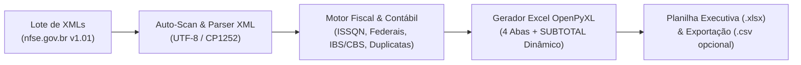

# 📊 Compilador de NFS-e Nacional (`XML` $\rightarrow$ `Excel Dinâmico`)


[-Compilador__NFSe.exe-1B6B53?style=for-the-badge&logo=windows&logoColor=white)](https://github.com/icaro-arch/compilador_NFSe/raw/main/Compilador_NFSe.exe)

Aplicação desktop em Python para leitura, auditoria fiscal e consolidação de lotes de **Notas Fiscais de Serviços Eletrônicas (NFS-e)** emitidas no **Padrão Nacional SPED (`nfse.gov.br`)**, gerando pastas de trabalho **Excel (`.xlsx`)** estruturadas com **somas e contagens 100% dinâmicas sob filtro (`SUBTOTAL`)**, agrupamento funcional de colunas e demonstrativos executivos.

---

## 🚀 Como Utilizar (Pronto para Uso — Sem Instalar Nada)

Para quem deseja apenas usar o programa no Windows, **não é necessário instalar Python nem nenhuma biblioteca**:

### Passo a Passo Rápido:
1. **Baixe o programa:** Clique no link direto abaixo para baixar o executável:
   - 👉 **[📥 Clique aqui para baixar o `Compilador_NFSe.exe`](https://github.com/icaro-arch/compilador_NFSe/raw/main/Compilador_NFSe.exe)**
2. **Abra o aplicativo:** Dê dois cliques no arquivo `Compilador_NFSe.exe` baixado *(caso o Windows exiba o aviso padrão do SmartScreen, clique em "Mais informações" $\rightarrow$ "Executar assim mesmo")*.
3. **Escolha a pasta dos XMLs:** Clique em **"Procurar Pasta..."** e selecione a pasta onde estão as notas fiscais em `.xml` baixadas do portal `nfse.gov.br`.
   - O programa fará a leitura instantânea das notas e **sugerirá automaticamente o nome do arquivo Excel** com base na empresa e competência identificadas.
4. **Gere a planilha:** Clique no botão verde **"▶ COMPILAR NOTAS E GERAR EXCEL"** e, em seguida, em **"📊 Abrir Planilha no Excel"**.

---

## 🎯 Principais Diferenciais

- **Interface Gráfica (`Tkinter`) com Pré-Leitura Inteligente (Auto-Scan):**
  - Ao selecionar uma pasta com arquivos `.xml`, o sistema inspeciona automaticamente o lote em milissegundos, exibindo em cards de diagnóstico:
    - Quantidade de notas fiscais válidas;
    - Empresa principal identificada (Tomador ou Prestador predominante);
    - Número de fornecedores distintos e período de competência;
    - Valor bruto total dos serviços.
  - **Sugestão Automática de Nome:** Preenche automaticamente o nome ideal para a planilha `.xlsx` com base na empresa ou no diretório analisado.
- **Somas e Contagens Dinâmicas Reativas a Filtros (`SUBTOTAL`):**
  - Diferente de planilhas estáticas que usam `=SUM(...)`, todas as **15 colunas financeiras e tributárias** utilizam `=SUBTOTAL(109, ...)` e `=SUBTOTAL(103, ...)`.
  - Ao filtrar qualquer critério no Excel (ex.: *Tipo Retenção ISS = `2 - Retido na Fonte`*, *Retenção INSS*, *Fornecedor*, *Município*, *Competência* ou *Obra*), **todas as somas de ISSQN, INSS, IRRF, CSLL, PIS, COFINS, IBS, CBS, Valor Bruto e Valor Líquido recalculam instantaneamente** considerando apenas as notas filtradas.
- **Reorganização Funcional de 70 Colunas + Grupos Retráteis (`+` / `-`):**
  - As colunas críticas para conferência fiscal e financeira ficam visíveis logo na abertura, enquanto dados cadastrais extensos (endereços, CEPs, telefones, e-mails e chaves de acesso) ficam agrupados com recurso nativo de *Outline Grouping* do Excel.
- **Blindagem de Codificação e Higienização (`UTF-8` / `CP1252`):**
  - Tratamento automático contra *mojibake* e caracteres de controle inválidos, garantindo acentuação impecável em todos os campos.

---

## 🏗️ Arquitetura e Fluxo de Processamento



---

## 📑 Estrutura da Planilha Gerada (4 Abas)

| Aba | Conteúdo e Funcionalidades |
| :--- | :--- |
| **1. `Resumo Financeiro Consolidado`** | Dashboard executivo com KPIs do lote, Demonstrativo Financeiro vinculado por fórmulas dinâmicas (`SUM`, `SUMIF`, `COUNTIF`), apuração da Reforma Tributária (**IBS / CBS**) e ranking **Top 10 Maiores Fornecedores**. |
| **2. `Notas Fiscais`** | Base analítica com **70 colunas** divididas em **7 blocos funcionais coloridos**, painel congelado (`D2`), destaque visual condicional para retenções na fonte e linha de **Total Filtrado** com `=SUBTOTAL(109, ...)`. |
| **3. `Resumo por Fornecedor`** | Consolidação por prestador de serviço com quebra explícita entre **ISSQN Retido na Fonte** vs. **ISSQN Não Retido**, retenções federais (`INSS`, `IRRF`, `CSLL`, `PIS`, `COFINS`), total retido e líquido a pagar. |
| **4. `Resumo por Município`** | Consolidação geográfica por município de execução do serviço, separando ISSQN retido, não retido e retenções federais com subtotais dinâmicos. |

### Organização dos 7 Blocos da Aba `Notas Fiscais`
1. **Identificação Essencial (`#1F4E79`):** `Número NFS-e`, `Competência`, `Razão Social Prestador`, `CNPJ Prestador`, `Data Emissão DPS`, `Status Duplicidade`, `Status (cStat)`.
2. **Enquadramento e Local (`#2F5597`):** `Regime Tributário (Simples Nacional)`, `Regime Especial`, `Município Prestação`, `Município Incidência`, `Cód. Obra`.
3. **Valores e ISS / ISSQN (`#1B6B53`):** `Tipo Retenção ISS`, `Valor Serviços (R$)`, `Deduções/Reduções (R$)`, `Desconto Incond. (R$)`, `Base Cálculo ISS (R$)`, `Alíquota ISS (%)`, `Valor ISSQN (R$)`.
4. **Retenções Federais e Valor Líquido (`#833C0C`):** `Retenções Federais Aplicadas` (filtro rápido), `Retenção INSS`, `Retenção IRRF`, `Retenção CSLL`, `Valor PIS`, `Valor COFINS`, `Total Retenções (R$)`, `Valor Líquido (R$)` *(+ detalhes de CST, Base e Alíquotas recolhíveis)*.
5. **Reforma Tributária — Novo SPED (`#4A3B7C`):** `IBS Alíquota UF (%)`, `IBS Alíquota Mun (%)`, `CBS Alíquota (%)`, `IBS Total (R$)`, `CBS Total (R$)`.
6. **Detalhamento do Serviço e Obra (`#2B5868`):** `Discriminação dos Serviços`, códigos e descrições de tributação nacional/municipal/NBS, informações complementares e endereço da obra.
7. **Cadastros Auxiliares e Chaves (`#4A5568` — Recolhível `+`/`-`):** Dados cadastrais completos do prestador e do tomador, códigos IBGE, números DFSe/DPS, chave de 50 dígitos e nome do arquivo XML.

---

## 🛠️ Para Desenvolvedores (Execução via Código-Fonte Python)

Caso deseje modificar o código-fonte ([`compilar_nfse.py`](compilar_nfse.py)) ou executar diretamente pelo Python:

### 1. Instalar dependências
```bash
pip install -r requirements.txt
```

### 2. Executar a Interface Gráfica via Python
```bash
python compilar_nfse.py
```

### 3. Executar via Linha de Comando (CLI / Automação)
```bash
python compilar_nfse.py --cli --input "examples" --output "demonstracao_nfse.xlsx"
```

### 4. Recompilar o Executável (`.exe`) após alterações no código
```bash
pip install pyinstaller
python -m PyInstaller --noconfirm --onefile --windowed --name "Compilador_NFSe" --distpath "." compilar_nfse.py
```

---

## 🔒 Privacidade e Sigilo Fiscal (`.gitignore`)

Este repositório está configurado por padrão para **ignorar qualquer arquivo `.xml` real, pastas de lotes fiscais e planilhas `.xlsx`/`.csv` geradas**, garantindo que nenhum dado sensível de contribuintes seja versionado acidentalmente. Apenas o arquivo fictício em [`examples/exemplo_nfse_nacional.xml`](examples/exemplo_nfse_nacional.xml) é incluído para fins de demonstração.

---

## 👤 Autor

Desenvolvido por **Icaro** ([`@icaro-arch`](https://github.com/icaro-arch)).
